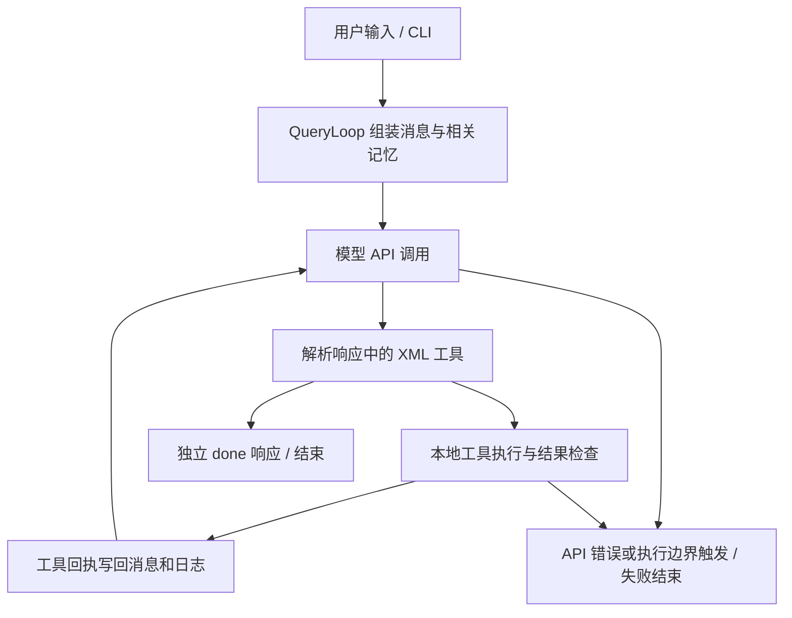

# MyClaude

基于大模型的本地编程 Agent，以及独立的 WDBuddy 桌面工作台原型。

项目起点是参考 Claude Code 的交互方式，学习如何把模型的文本输出变成真实的文件操作和命令执行。核心关注三个问题：如何完成多轮工具调用、如何复用历史经验，以及如何验证任务确实完成。模型通过 API 调用，文件操作和命令在本机执行。

目前已经验证 Python CLI 的真实模型调用与文件交付，以及 WDBuddy 的构建和桌面启动。项目仍处于开发阶段，完整测试尚未全部通过。“自我进化”是长期探索方向，目前指记忆提取、整理和经验归纳机制，尚未证明系统能够自主改进代码或持续提升任务成功率。

## 仓库中有两套应用

| 应用 | 定位 | 技术栈 | 启动入口 |
| --- | --- | --- | --- |
| MyClaude CLI | 终端编程助手，读取、创建、修改文件并执行命令 | Python、OpenAI SDK、Rich、prompt-toolkit、YAML、FAISS | 根目录 `start.bat` 或 `python -m src.myclaude` |
| WDBuddy | 面向办公任务的桌面 Agent 原型，包含任务规划、执行和产物展示 | Electron、React、TypeScript、Zustand、SQLite、pnpm/Turbo | `wdbuddy/start.bat` |

两套应用的运行时和模型配置相互独立。WDBuddy 有自己的 TypeScript Agent Runtime，不是 Python CLI 的图形界面。详见 [WDBuddy README](wdbuddy/README.md)。

## 核心能力与实现边界

| 模块 | 已实现内容 | 当前边界 |
| --- | --- | --- |
| 多轮执行 | 模型决策 → 工具解析 → 本地执行 → 结果反馈 → 下一轮 | 依赖模型遵守工具协议，仍需任务级验收 |
| 文件与命令工具 | 文件查看、创建、精确替换、命令执行、Excel 查看、文件上下文 | Python CLI 没有完整的进程或文件系统沙箱 |
| 运行防护 | 已有非空文件禁止直接覆盖、替换失败如实返回、重复工具熔断、轮数限制、API 错误终止 | 这些检查不能替代操作系统权限隔离 |
| 长期记忆 | Markdown 记忆、FAISS 粗召回、LLM/重排模型精排、预算内注入、Bug 经验库 | 辅助模型需单独配置；记忆收益尚未量化 |
| 可扩展指令 | `skill/<name>/SKILL.md` 技能加载、Markdown 斜杠命令 | 技能依赖提示词约束，不等同于安全隔离 |
| 可观测性 | 会话日志、工具回执、Token 统计、测试模式 JSON 输出 | 退出码成功仍需结合实际产物检查 |
| A2A 测试实验 | 编排服务、单元/系统测试执行、LLM 判定和报告 | 已有 CLI 入口，完整服务链路尚未全部验证 |
| 桌面工作台 | 独立 Runtime、三栏界面、模型设置、任务存储、PPT/HTML 产物工具 | 沙箱测试仍有失败；持久化恢复、部分云端能力未完成 |

## 快速开始：Python CLI

### 1. 准备 Python 环境

以下命令使用 Windows PowerShell，并以本机目录 `D:\HKU\Project\MyClaude` 为例。克隆到其他位置时，替换示例中的项目路径。

已验证环境：Python 3.11.4、conda 环境 `LLMs`。如果已有该环境，直接激活；仅在没有时创建：

```powershell
# 仅首次且尚未创建环境时执行
conda create -n LLMs python=3.11 -y
```

```powershell
conda activate LLMs
Set-Location D:\HKU\Project\MyClaude
python -m pip install -r requirements.txt
```

也可以在根目录执行 `.\pip_install.bat`，脚本会通过 `conda run -n LLMs` 安装依赖。`openai` 是调用模型的客户端库，安装它之后仍然需要有效的模型服务密钥。

### 2. 配置模型

仅在本地密钥文件不存在时复制模板，避免覆盖已有配置：

```powershell
if (-not (Test-Path -LiteralPath .\config\model_key.yaml)) {
    Copy-Item -LiteralPath .\config\model_key.example.yaml -Destination .\config\model_key.yaml
}
```

编辑 `config/model_key.yaml`，填写目标 provider 的 `api_key`、`base_url`、`model_name`，并让 `main_model.provider` 指向该配置段。例如模板中的主模型选择是：

```yaml
main_model:
  provider: DeepSeek
```

模型名以账户实际可用的模型为准；配置模板不代表所有列出的模型均已验证。当前本机已用 DeepSeek 完成真实文件操作测试。

不同功能使用的模型配置并不相同：

| 配置项 | 用途 |
| --- | --- |
| `main_model.provider` | 主对话和工具决策 |
| `simple_chat.provider` | 记忆提取等辅助 LLM 调用 |
| `memory.embedding.provider` | 记忆向量化 |
| `memory.llm_re_ranking.provider` / `memory.rerank_re_ranking.provider` | 对应策略下的召回精排 |
| `web_search` | 搜索服务，独立配置密钥 |

只填写 DeepSeek 主模型密钥，不会自动配置上述辅助服务。如果先验证最小编程流程，可在 `config/config.yaml` 将 `memory.backend` 设为 `none`、`web_search.enabled` 设为 `false`，等辅助服务准备好再启用。

`config/model_key.yaml` 已加入 Git 忽略规则；共享配置使用无密钥的 `config/model_key.example.yaml`。不要把真实密钥填进模板或测试产物。

### 3. 启动

```powershell
Set-Location D:\HKU\Project\MyClaude
.\start.bat
```

根目录脚本固定使用 `LLMs` 环境，并转发命令行参数。也可以在已激活的环境直接运行：

```powershell
python -X utf8 -m src.myclaude
```

默认角色为 `mycode`，当前也只支持该角色。代理沿用终端的 `http_proxy` / `https_proxy`，启动脚本不设置占位代理。配置中的相对目录按仓库根目录解析；显式绝对路径保持原样。修改配置后重启生效。

### 4. 验证真实执行

下面的测试会调用真实模型，读取配置首行，并在 `code_output/` 创建一个带时间戳的标记文件。它使用唯一文件名，便于重复演示：

```powershell
conda activate LLMs
Set-Location D:\HKU\Project\MyClaude
$demoId = Get-Date -Format yyyyMMdd_HHmmss
$demoFile = "D:/HKU/Project/MyClaude/code_output/demo_$demoId.txt"
$demoReport = "D:/HKU/Project/MyClaude/code_output/demo_$demoId.json"
$demoPrompt = "用 file_view 只读取 D:/HKU/Project/MyClaude/config/config.yaml 的第一行。然后用 create 创建 ${demoFile}，内容仅为 MYCLAUDE_RUNTIME_OK。不要执行命令或联网，不修改其他文件。创建成功后，在独立的一轮中用 done 结束。"
python -X utf8 -m src.myclaude --test-mode --prompt $demoPrompt --test-output $demoReport
$demoExit = $LASTEXITCODE
Get-Content -LiteralPath $demoFile
$demoResult = Get-Content -LiteralPath $demoReport -Raw | ConvertFrom-Json
$demoResult | Select-Object exit_code, error, tool_calls
Write-Output "Process exit code: $demoExit"
```

验收时同时确认：进程退出码为 `0`、JSON 的 `error` 为空、工具记录包含 `file_view` 和 `create`、文件内容为 `MYCLAUDE_RUNTIME_OK`。看到模型说“完成”本身不足以证明任务成功。测试 JSON 包含会话内容，默认留在被 Git 忽略的输出目录。

### 常用交互命令

| 命令 | 作用 |
| --- | --- |
| `/help` | 查看交互帮助 |
| `/quit`、`/exit`、`/q` | 退出 |
| `/cls` | 清屏 |
| `/new session` | 开启新会话、重置上下文；保留持久化记忆 |
| `/tokens`、`/t N` | 查看 Token 统计、展开指定轮次的思考输出 |
| `/mem` | 查看记忆命令；如 `show`、`extract`、`embedding`、`retrieve`、`compaction`、`evolution` |
| `/bug` | 查看 Bug 经验库相关命令 |
| `/init`、`/init file` | 生成工程树、函数级摘要 |
| `/cs [目录]` | 统计代码行数 |
| `/test --help` | 查看测试生成、执行及 A2A 入口 |
| `/opsx` | 列出已注册的 OpenSpec 斜杠命令 |
| `/save <文件名> [all]` | 保存屏幕输出 |
| `/h2m <源HTML> <目标MD> [轮次] [小节]` | 转换 HTML 日志 |

## 工作原理

### Python Agent 执行循环



主要调用链：`src/myclaude.py` → `src/cli/mycli.py` → `src/query/query_loop.py` → `src/query/chat_llm.py` → `src/llm_tool/tool_executor.py`。

核心循环为同步执行。模型接口使用流式响应读取，但 CLI 主要在收集响应后展示，不能把它描述成完整的逐 Token 实时终端渲染。`stream_chat()` 返回内容、截断标记、推理内容和 usage 四项结果。

模型通过 XML 描述操作，例如：

```xml
<file_view path="D:/HKU/Project/MyClaude/README.md" limit="20"/>
```

工具回执进入后续消息，模型据此决定下一步。协议要求文件路径为绝对路径，创建和替换带 `summary`，修改前先读取原文，工具调用与 `<done>` 分轮输出。解析器还处理代码块和部分不规范标签；提示词约束与实际执行检查需要分别理解。

### 记忆与经验复用

当前后端为 `src/memory_ex/`，配置位于 `config/memory/memory_ex.yaml`：

1. 会话保存为 Markdown 日志，记忆提取器从日志中提炼条目。
2. 条目与元数据保存在 `memory_storage/memory_ex/` 下的 `memory/MEMORY.md` 和 `memory/metadata.json`。
3. 按配置选择向量粗召回、LLM 精排或其他召回策略；默认策略为 `coarse_llm`。
4. 相关记忆在 Token 预算内注入新任务；引用文件的任务可延迟到文件读取后再召回。
5. 整理、经验归纳和 Bug 库提供进一步管理入口。当前自动整理、自动进化开关均为关闭。

后端初始化失败会降级到 `NoopMemory`。这种降级保障基础流程可继续，不代表记忆功能正常。上下文压缩组件虽已存在，尚不能据此宣称主循环已经完成自动上下文压缩接入。

### WDBuddy 进程边界

```text
React Renderer ── IPC ── Electron Main ── JSON-RPC/stdio ── Agent Runtime
   界面与状态               窗口、存储、凭据                 规划、工具执行、验证
```

桌面端通过共享类型定义通信协议，使用 SQLite WAL 保存任务相关数据，工具执行接入 `policy-engine` 与 `fs-guard`。当前 Runtime 使用内存检查点，数据库中有相关结构并不意味着跨进程恢复已经实现。

## 启动 WDBuddy

需要 Node.js >= 20.11，仓库指定 pnpm 9.12.3。本机已验证 Node.js 24.19.0；conda 环境中有 `openai` 不会提供 `pnpm`。

Windows PowerShell 首次准备：

```powershell
Set-Location D:\HKU\Project\MyClaude\wdbuddy
npm.cmd install --global pnpm@9.12.3
pnpm.cmd install --frozen-lockfile
node scripts/rebuild-electron-natives.mjs
# 可选：PPT 模板预览/克隆需要启动终端中的 Python 具备此依赖
python -m pip install python-pptx
.\start.bat
```

之后在 `wdbuddy/` 执行 `.\start.bat` 即可。`.cmd` 调用也可避开 PowerShell 对 `pnpm.ps1` 的执行策略限制。桌面应用需在“设置 → 模型”单独配置密钥。

如果系统 Node 和 Electron 的 SQLite 原生模块 ABI 不一致，重新执行 `node scripts/rebuild-electron-natives.mjs`。完整说明见 [WDBuddy README](wdbuddy/README.md)。

## 目录结构

```text
MyClaude/
├── src/
│   ├── myclaude.py       # Python 入口
│   ├── cli/              # 交互、显示、斜杠命令
│   ├── query/            # Agent 循环、模型调用、消息管理
│   ├── llm_tool/         # XML 工具解析、文件与命令操作
│   ├── tools/            # 搜索、文件上下文、测试生成等扩展
│   ├── memory_ex/        # 记忆存储、召回、提取、整理、经验归纳
│   ├── command/          # Markdown 命令注册与加载
│   ├── utility/          # 配置、技能加载、通用工具和回归测试
│   └── A2A/              # 编排及测试服务实验
├── config/               # 全局参数、模型密钥模板、记忆配置
├── skill/                # SKILL.md 技能
├── .myclaude/commands/   # OpenSpec 等斜杠命令
├── wdbuddy/              # 独立的桌面应用工作区
├── docs/                 # 项目文档与面试讲解
├── code_output/          # 临时产物与测试输出，默认不提交
├── log/                  # 运行日志，默认不提交
├── memory_storage/       # 本地记忆，默认不提交
├── token_statistics/     # Token 使用记录，默认不提交
├── start.bat             # Python CLI 启动脚本
└── requirements.txt      # Python CLI 依赖
```

## 验证记录与测试命令

以下为 **2026-10-21、本机 Windows 环境**中的验证记录；测试数量不等于覆盖率，也不代表全部功能通过验收。

| 检查 | 结果 |
| --- | --- |
| Python 启动和工具回执回归 | 10 项通过，不调用真实模型 |
| Python 源码语法解析 | 84 个文件通过 |
| Python 严重语法/未定义名称检查 | `ruff check --select E9,F821 --no-cache src` 通过；未宣称完整 lint 通过 |
| DeepSeek 真实执行 | `file_view → create → done` 完成，检查了文件、JSON 和退出码 |
| WDBuddy 构建 | 10 个构建任务通过 |
| WDBuddy 桌面冒烟 | 实际窗口、preload API、任务数据库接口通过；普通 Windows PATH 下启动通过 |
| WDBuddy Agent Runtime / 模型路由 | 分别 60 项 / 8 项通过 |
| WDBuddy 沙箱 | 34 项通过、5 项失败，尚未全部通过 |
| 完整端到端 / A2A 服务链路 / 安装包 | 尚未完成完整验证 |

Python 定向回归，在根目录和 `LLMs` 环境执行：

```powershell
python -X utf8 -m unittest src.utility.test_runtime_regressions -v
```

WDBuddy 在其目录执行：

```powershell
pnpm.cmd build
pnpm.cmd --filter @wdbuddy/agent-runtime test
pnpm.cmd --filter @wdbuddy/model-gateway test
pnpm.cmd --filter @wdbuddy/sandbox test
```

仓库还提供 `pytest`、`ruff check .`、`pnpm.cmd test` 和 `pnpm.cmd e2e` 入口，但它们不包含在“全部通过”的承诺中。`pnpm.cmd test` 通过 Turbo 执行工作区测试，也会涉及 E2E，不应当作纯单元测试。A2A 的额外依赖见 `src/A2A/requirements.txt`，不属于最小 CLI 启动要求。

## 当前最值得完善的内容

按本地演示、面试和后续可交付性排序：

1. **安全与权限边界**：修复 WDBuddy 的 5 项沙箱测试，核对 Windows 路径、符号链接和权限决策；为 Python 命令执行补充授权目录、操作确认或进程隔离；修复模型客户端中硬编码的 `verify=False`，恢复 TLS 证书校验。
2. **任务验收与成本控制**：建立读文件、改代码、运行测试等可重复的任务集，覆盖 API 失败、重复调用、错误回执；统一检查真实产物。根据 provider 能力约束输出上限、总轮数、时间与 Token 预算，避免沿用过大的默认值。
3. **配置与记忆验证**：启动时检查主模型及辅助服务配置，明确降级状态；通过有记忆/无记忆对照任务衡量召回相关性、任务成功率和成本；同步仍引用旧路径、旧后端的历史说明。
4. **桌面恢复与产品化**：接通持久化检查点及真正的暂停/恢复，再推进安装包、自动更新与云端能力。微信登录、云端模型代理、技能签名和移动端目前仍含演示或占位实现。

面试准备详见 [项目介绍与面试问答](docs/interview-guide.md)，包含可直接口述的介绍、架构讲解、真实故障案例和演示步骤。

## 常见问题

| 现象 | 排查方式 |
| --- | --- |
| `No module named openai` | 在当前解释器执行 `python -m pip install -r requirements.txt`；检查 `python -c "import sys; print(sys.executable)"` 是否指向 `LLMs` |
| `pnpm` 无法识别 | 安装 `pnpm@9.12.3`，使用 `pnpm.cmd`；检查 `Get-Command node.exe, pnpm.cmd` |
| 模型返回 401 | 确认正在使用的 `main_model.provider`，更新该段密钥、地址；不要只修改未被选择的 provider |
| 主对话正常，记忆或搜索失败 | 检查辅助 provider 和搜索的独立配置；主模型密钥不会自动复用到所有服务 |
| 创建文件被阻断 | 目标已存在且非空；先查看再精确替换，演示使用新文件名 |
| SQLite 提示 `NODE_MODULE_VERSION` 不匹配 | 在 `wdbuddy/` 运行原生模块准备脚本，再启动桌面 |
| 端口或窗口启动异常 | 区分两个 `start.bat`，查看对应终端输出和日志；不要同时启动多个开发实例 |

## Git 与回滚

当前仓库远程为 `origin`（GitHub），分支为 `main`。每次完成修改并通过相关验证后，提交、推送，以提交记录作为回滚依据。密钥、运行日志、临时输出和本地记忆不随普通代码提交上传。

```powershell
git log --oneline -n 10
# 需要撤回某次已推送修改时，用实际提交号替换 COMMIT_ID
git revert COMMIT_ID
git push origin main
```

`git revert` 会创建反向提交并保留历史；回滚代码不会还原被忽略的本地密钥、记忆和其他运行数据。
